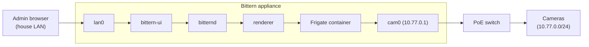

# Bittern

**A quiet appliance for Frigate.**

Bittern is an open-source appliance layer around Frigate NVR: a reproducible OS image, a management
agent, and a small web UI that together turn a commodity two-NIC x86 mini-PC and a PoE switch into a
local-first camera appliance. Frigate does the video work. Bittern makes the device installable,
updatable, recoverable, and safe to hand to someone who does not want to administer a Linux server.

## Who it is for

- **The builder.** A technical person who flashes the image, joins the appliance to the house LAN,
  connects a PoE switch to the camera port, onboards cameras, and supports the device afterwards.
- **The operator.** A household member or small-site user who watches live views and recordings,
  receives alerts, and performs simple actions such as restarting a camera, without touching a shell
  or editing configuration files.
- **The future maintainer.** A developer or coding agent who inherits the project and needs the
  reasoning behind it, not just the code. The documentation set is written for this reader first.

## Status

Pre-implementation. This repository contains the design documentation, schema version 2, the
reference validator, and the first product code: the Go configuration loader and deterministic
renderer for networkd, nftables, dnsmasq, chrony, Frigate config, compose, and the Frigate unit,
read-only hardware detection, the resumable apply and first-boot path, the status daemon, and the
first-run wizard and status page skeleton with vendored HTMX. There is no image build or release
artifact yet. CI phase one is running under
[ADR 0032](docs/adr/0032-continuous-integration-and-build-pipeline.md):
[`.github/workflows/check.yml`](.github/workflows/check.yml) runs `make check` on every push to
`main` and on every pull request, then builds an unsigned POC payload test artifact. The release
channel is decided in [ADR 0031](docs/adr/0031-update-channel-on-github-releases.md) and is not live.
The sequence of work to reach a first appliance release is in
[the implementation plan](docs/plan/implementation-plan.md). Facts about Frigate are dated
2026-11-14 and sourced in [the Frigate assessment](docs/research/frigate-assessment.md).

## Shape of the appliance

The camera segment is a leaf network: DHCP and NTP only, no forwarding, and no general DNS. Remote
support, when enabled, runs over a Tailscale tailnet with outbound connections only. The full design
is in [docs/architecture.md](docs/architecture.md).

## Components

The monorepo layout is defined in [ADR 0011](docs/adr/0011-monorepo-layout-and-naming.md). Each
component directory has a README describing its boundaries and status.

| Component | README | Role |
| --- | --- | --- |
| Image | [image](image/README.md) | Reproducible Debian image, partitions, A/B slots, signing |
| Agent | [agent](agent/README.md) | `bitternd` daemon, `bittern` CLI, and the offline `bittern-release` signing tool |
| UI | [ui](ui/README.md) | First-run, onboarding, status, updates, logs, support, reset |
| Schema | [schema](schema/README.md) | `appliance.yaml` schema, versions, migrations, examples |
| Templates | [templates](templates/README.md) | Renderer inputs for networkd, nftables, dnsmasq, chrony, compose |
| Defaults | [defaults](defaults/README.md) | Product defaults for networks, timeouts, channels, pins |
| Tests | [tests](tests/README.md) | Golden renders, QEMU, virtual cameras, update and hardware tests |
| Fleet | [fleet](fleet/README.md) | Optional GitOps bundles, not part of v1 |

## What Bittern is not

- Not a fork of Frigate, and not a redistribution of a modified Frigate image.
- Not a cloud service. There is no Bittern account and no vendor backend.
- Not a turnkey commercial product with a warranty, support contract, or certification. It is a
  self-built appliance with a documented design.

## Documentation

| Document | What it covers |
| --- | --- |
| [docs/vision.md](docs/vision.md) | Problem, users, principles, v1 scope, and success criteria |
| [docs/architecture.md](docs/architecture.md) | Layers, network design, runtime components, config and update flows |
| [docs/adr/README.md](docs/adr/README.md) | Decision records and their current status |
| [docs/research/frigate-assessment.md](docs/research/frigate-assessment.md) | Dated findings on Frigate, licensing, security, and privacy |
| [docs/research/options-considered.md](docs/research/options-considered.md) | Alternatives evaluated before choosing Frigate |
| [docs/research/agent-language-spike.md](docs/research/agent-language-spike.md) | Dated Python versus Go evidence for the agent language |
| [docs/open-questions.md](docs/open-questions.md) | Undecided questions that must not be silently answered |
| [docs/plan/implementation-plan.md](docs/plan/implementation-plan.md) | Phased plan from documentation to a release |
| [docs/engineering/README.md](docs/engineering/README.md) | Defect classes, field parity, and how a rule becomes a check |
| [docs/runbooks/gk41-poc.md](docs/runbooks/gk41-poc.md) | Manual Debian 13 POC install and first GK41 hardware run |
| [docs/notes/2026-11-14-initial-design-session.md](docs/notes/2026-11-14-initial-design-session.md) | Narrative record of the founding design session |
| [LICENSE](LICENSE), [TRADEMARK.md](TRADEMARK.md), [THIRD_PARTY_NOTICES.md](THIRD_PARTY_NOTICES.md) | License, trademark policy, and third-party notices |
| [AGENTS.md](AGENTS.md) | Working rules for coding agents in this repository |

## Prior art and relationship to Frigate

Bittern is an independent project. It uses Frigate unmodified as a container image, pinned by
digest, and treats Frigate's own UI and API as the NVR interface. Bittern is not affiliated with,
sponsored by, or endorsed by Frigate, Inc. The product name deliberately avoids the Frigate
trademark, and Bittern does not use the Frigate logo. Frigate, Frigate NVR, and Frigate+ are
trademarks of Frigate, Inc.; Frigate's trademark policy requires forks and products to rename and
remove the logo (verified 2026-11-14, see
[the assessment](docs/research/frigate-assessment.md)).

Bittern's own branding, naming, and licensing constraints are recorded in ADR 0013, listed in the
[ADR index](docs/adr/README.md).

## License

Bittern's own code and documentation are licensed under the [MIT License](LICENSE). MIT permits
use, modification, and redistribution with attribution, and it comes with no warranty.

The MIT License covers code and documentation only. The Bittern name and logo are not licensed
under MIT; see [TRADEMARK.md](TRADEMARK.md). Bundled and separately distributed components, such as
Frigate, go2rtc, detection models, and ffmpeg, keep their own licenses; see
[THIRD_PARTY_NOTICES.md](THIRD_PARTY_NOTICES.md).

## Local checks

A clean clone runs the offline checks with `make check`. The same target runs in CI on every push to
`main` and on every pull request, so a local pass and a CI pass mean the same thing. This covers
Markdown links,
`appliance.yaml` schema validation, Markdown style, the pinned Frigate fixture bundle, and the Go
test suite. `make test` runs the Go tests offline and `make render` runs the golden render suite;
both need the pinned Go toolchain and vendored modules described in
[agent/README.md](agent/README.md). Run `make help` to list the individual targets. The check
scripts are in `tests/checks/`. Link and style checks use only the Python standard library; schema
validation needs the Debian packages listed in [schema/README.md](schema/README.md).

## Contributing

The project is not ready for external contributions. The design is still moving, and the only code
so far is the narrow configuration pipeline. If you are working in this repository anyway, read
[AGENTS.md](AGENTS.md) first: it defines the reading order, the documentation conventions, and the
rules that keep the design coherent.
