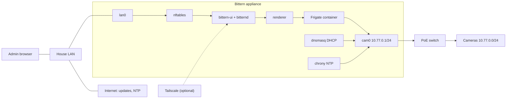

# Architecture

Bittern is one Debian appliance with two network interfaces, a declarative configuration pipeline,
and two update loops. This describes the intended design; missing components say so in their README.
Decisions are in the [ADR index](adr/README.md). Frigate facts are dated 2026-11-14 and sourced
in [the Frigate assessment](research/frigate-assessment.md); the live view facts were re-verified on
2026-11-26 in [the upstream verification note](notes/2026-11-26-live-view-upstream-verification.md).

## System context

A Bittern appliance sits between a house LAN, a private camera segment, and optional remote access.

- **House LAN and internet.** Admin browsers reach only the Bittern UI, which is server-rendered Go
  templates with HTMX over TLS on 443 ([ADR 0019](adr/0019-ui-stack.md)). Live video is a Bittern
  page on the same surface, using go2rtc MSE or HLS through `bitternd`
  ([ADR 0034](adr/0034-live-view-owned-by-bittern.md)); the wall, per-pane quality and full-screen
  rules are in [ADR 0037](adr/0037-nvr-grid-per-pane-quality-and-full-screen.md). Frigate's UI is not
  exposed on `lan0`; 8971
  binds to loopback, and deliberate support access uses the planned tailnet-only `tailscale serve`
  path in [BIT-022](plan/implementation-plan.md#bit-022-tailscale-remote-access-and-frigate-ui-support-path).
  Live view, event review, playback and camera settings are planned as Bittern UI surfaces in
  BIT-023 to BIT-026, with the tailnet-only Frigate UI as the interim verification path described in
  [the NVR and Tailscale note](notes/2026-11-15-nvr-tailscale-interim-path.md). Robust ONVIF
  profiles, PTZ, and field interoperability follow in
  [BIT-027](plan/implementation-plan.md#bit-027-robust-onvif-profiles-ptz-and-field-interoperability).
  This is the default route and the outbound path for signed updates, container pulls, and NTP; no
  inbound ports exist from the internet.
- **Camera segment.** Cameras live on `10.77.0.0/24` behind `cam0` at `10.77.0.1/24` on a PoE switch,
  with no forwarding, no general DNS, and no route to the LAN or internet.
- **Tailscale and cloud features.** Tailscale is an optional outbound-only support path. Frigate+ and
  GenAI are off by default and add external uploads and licensing obligations when enabled.

## Three layers and two loops

The system is split into layers that change at different speeds. Updates are the only way the first
two layers change on a running device.

| Layer | Contents | Changed by | Rollback unit |
| --- | --- | --- | --- |
| OS image (`bittern-os`) | Debian 13 minimal, kernel, Docker, Tailscale, systemd units | OS update loop, reboot | A/B slot |
| App bundle | `bitternd`, CLI, `bittern-ui`, schema, templates, defaults, compose, pinned Frigate digest | Application update loop | Bundle generation |
| Device config | `appliance.yaml`, schema version, site settings, camera inventory, managed fragments | UI, CLI, optional fleet bundle | Config generation |
| State | Recordings, Frigate database, DHCP leases, secrets, logs, backups | Runtime | Restore or erase |

**Loop 1, OS image.** Infrequent and disruptive. The image is written to the inactive slot,
verified, selected at boot, and health-checked. If boot does not reach a healthy agent, the watchdog
returns to the previous slot. This is the only loop that requires a reboot.

**Loop 2, application bundle.** Frequent and mostly non-disruptive. A signed bundle is verified,
staged, and activated as a generation. Migrations run before the new services start, and a health
gate commits the generation or restores the previous one. Frigate is part of this layer, pinned by
digest.

## Dual-NIC network

`lan0` has the only default route. `cam0` is static, gatewayless, and IPv6-disabled. `nftables`
defaults to deny input and forward and allows admin access only to the Bittern UI, whose stack and
port are fixed by [ADR 0019](adr/0019-ui-stack.md). The renderer accepts 443 on `lan0`, and on
`tailscale0` when Tailscale is enabled. Frigate's UI and API are not LAN services: `8971` and `5000`
bind loopback, and go2rtc's `1984` and `8554` stay blocked from `lan0`. Live view uses MSE or HLS
through the authenticated 443 surface, so WebRTC on `8555` also stays closed
([ADR 0034](adr/0034-live-view-owned-by-bittern.md),
[ADR 0037](adr/0037-nvr-grid-per-pane-quality-and-full-screen.md)). Cameras cannot reach the LAN,
internet, or each
other except for their streams. Docker host networking keeps container traffic under the same
firewall instead of bypassing it through NAT.

`dnsmasq` listens only on `cam0`: DHCP pool `.50` to `.199`, reservations `.10` to `.49`, option 42
for NTP, and a gateway option pointing at the appliance for camera compatibility, with no forwarding
and no general DNS. `chrony` is a client on `lan0` and an NTP server on `cam0`.

The appliance is the time authority for the camera segment
([ADR 0035](adr/0035-appliance-as-time-authority.md)). The rendered chrony configuration is a client
on `lan0` (`bindacqdevice lan0`, the provisional `pool.ntp.org` source set from
[OQ-20](open-questions.md)) and a server on `cam0` only (`bindaddress <cam0 address>`,
`allow <cam0 subnet>`). The firewall accepts UDP 123 on `cam0` and nowhere else; a management client
that asks the appliance for time gets no answer. `makestep 1.0 3` steps a large correction only in
the first three clock updates, `rtcsync` keeps the hardware clock in UTC, and `local stratum 10`
keeps cameras on one clock when no source is reachable. `chronyd` does not correct the clock without
a source, and the status `time` section reports `never-synchronised` or `drifted` in plain language
rather than claiming the clock is right.

Nothing in the boot path waits for synchronisation: first boot is ordered after local filesystems and
before `bitternd`, with no ordering against `chrony.service`, and the installer disables
`chrony-wait.service` and `systemd-time-wait-sync.service`. The appliance boots and serves time to
cameras on a network with no internet. On the camera side, `bitternd` detects per camera whether it
accepts the appliance NTP server, a pushed time, both, or neither. It prefers NTP, falls back to the
pushed time, verifies the result, and reports a per-camera clock state without blocking adoption. A
camera that refuses time is still adopted and recorded. The endpoint rule, schedule, and unverified
device behaviour are in [the camera time note](notes/2026-11-27-camera-time-onvif.md).

## Runtime components

Trust: low is unprivileged and network-facing, medium is reduced, high is root-equivalent.

| Component | Runs as | Responsibility | Trust |
| --- | --- | --- | --- |
| `bittern-ui` | Unprivileged systemd service | First run, onboarding, live view, status, updates, logs, support bundle, reset; calls the agent API | Low |
| `bitternd` | Root systemd service | Schema, rendering, apply and rollback, discovery, health, update client, reset, authenticated media proxy | High |
| `bittern first-boot` | Root oneshot before `bitternd` | Identity, secrets, TLS certificate, minimal config, first apply, completion marker | High |
| `bittern` CLI | Caller privileges | Operator and debug front end over the same agent API | High when root |
| Frigate container | Root in container, host network | NVR engine, recordings, Frigate UI and API, go2rtc | High |
| go2rtc | Inside Frigate | RTSP restreaming, MSE and HLS for live view; WebRTC is unused in v1; unauthenticated port 1984 is upstream behavior, blocked by the firewall | High |
| Docker | Root daemon | Container lifecycle, digest pulls, log rotation | High |
| systemd-networkd | Root | Interface addressing and routes | High |
| nftables | Root, kernel | Input and forward policy, LAN and camera isolation | High |
| dnsmasq | Reduced user after bind | DHCP only on `cam0`; no DNS service | Medium |
| chrony | Reduced user after bind | Time client on `lan0`, NTP server on `cam0` | Medium |
| Tailscale | Root daemon | Optional outbound remote access and support | High |

Frigate details are upstream behavior verified 2026-11-14 and re-verified for live view on
2026-11-26: the container runs as root, ports 5000 and 1984 are unauthenticated, and the admin
password is printed to logs. Contain, do not patch. The live view uses go2rtc's documented MSE and
HLS endpoints through `bitternd` and does not expose the Frigate UI or the go2rtc web player
([ADR 0034](adr/0034-live-view-owned-by-bittern.md)).

## Status and state

`bitternd` serves one read-only status document on loopback. The overall state is `booting`, `ready`,
`degraded`, `updating`, or `failed`, and each section reports its own state. Config and render faults
fail the appliance; an unreachable Frigate or a recording-storage fault degrades it. A recording
drive that is not attached, is attached but not mounted, or is mounted but fails its write test sets
the storage detail state and degrades the appliance, because nothing is recording and the fault needs
the owner. Storage faults never resolve into a healthy-looking page. The render section also
reports the applied generation and the last apply state from `apply.Inspect`, so a failed or
rolled-back transaction stays visible without inventing a new current generation. Update and reset
data are explicitly unknown until BIT-009 and BIT-010 implement their records. Hardware detection
adds CPU, memory, and accelerator evidence when the probe succeeds. The `time` section reports the
appliance clock state, source, offset, last successful update, and zone from read-only `chronyc`
commands, and each camera carries its own clock state
([ADR 0035](adr/0035-appliance-as-time-authority.md)). The schema, fields, redaction rules, and API
are in [status.md](status.md).

## Configuration flow

The UI and CLI never write rendered system files; they write `appliance.yaml` and ask the agent to apply it.

1. The UI, CLI, or a fleet bundle submits a new `appliance.yaml`.
2. `bitternd` validates it against the schema version, runs pending migrations on a copy, and rejects
   unknown or unsafe values.
3. The renderer combines config, defaults, and templates into an immutable generation directory.
   Live files are never edited in place.
4. Output is validated: `nft -c` and `dnsmasq --test` for network services, `docker compose config`
   for the container definition, and the Frigate config check for managed Frigate fragments.
5. Apply atomically, reload services in dependency order, and health-check links, DHCP, firewall
   policy, the agent API, the UI, and the Frigate API. Commit on success; otherwise restore the
   previous generation and surface the reason in the UI.

On a fresh install, `bittern first-boot` runs as a root oneshot after local filesystems and before
`bitternd`. It detects hardware, reuses or generates identity and secrets, creates the TLS
certificate, writes a minimal `appliance.yaml`, renders and applies the first generation, and writes
`<state-root>/first-boot.json` only after commit. A missing marker after power loss runs the same
idempotent path again. With schema version 3, first boot writes the detected NIC match, detector, and
video decode fields into `appliance.yaml`; the renderer owns `10-lan0.link` and `10-cam0.link` when a
match is configured.

Rendered outputs are networkd interface and `.link` files, nftables rules, dnsmasq and chrony
configuration, Frigate's `config.yml`, the compose file, and the `bittern-frigate.service` oneshot.
Apply also writes the generated camera env file from `/etc/bittern/secrets.yaml`; the renderer never
reads or writes a secret value. Generated files are never hand-edited on a device.

Frigate's `config.yml` is generated from `appliance.yaml` by `bitternd`, which is the only writer.
There is no mirroring and Frigate's UI is not a source of camera changes. A configuration with no
enabled cameras renders no Frigate config, compose file, or unit, because Frigate with zero cameras
is not a valid service.

## Data and state

| Path | Contents | Backup posture | Erase posture |
| --- | --- | --- | --- |
| `/etc/bittern/appliance.yaml` | Device config, schema version, camera inventory | Included in config backups | Factory reset |
| `/etc/bittern/secrets.yaml` | Generated secrets, including the TLS private key, mode 0600 | Excluded; use SOPS or manual escrow | Factory reset or wipe and reset, then regenerate |
| `/etc/bittern/generated/` | Rendered network, firewall, DHCP, NTP, compose files | Not backed up; regenerated | Regenerated |
| `/var/lib/bittern/frigate/config.yml` | Frigate config, generated from `appliance.yaml` | Included in config backups | Factory reset |
| `/var/lib/bittern/frigate/cameras.env` | Generated camera RTSP URL env file, mode 0600, sourced from `/etc/bittern/secrets.yaml` | Excluded, like the secrets file | Factory reset or wipe and reset |
| `/var/lib/bittern/media/` | Recordings, snapshots, and the Frigate media database on a pool of one or more dedicated recording drives; a failed member loses only its share | No v1 recording backup ([OQ-16](open-questions.md)); media database included in update backups | Factory reset keeps the pool, recordings, snapshots, and database; reflash, OS update, and bundle rollback also keep them; wipe and reset logically deletes all three across every member ([ADR 0017](adr/0017-reset-levels-and-decommissioning.md), [ADR 0018](adr/0018-recording-capacity-pool.md)) |
| `/var/lib/bittern/backups/`, `app/` | Update backups and bundle generations | Previous generation kept for rollback | Factory reset |
| `/var/lib/docker/volumes/` | Docker volumes and the Frigate cache | Not backed up; the cache is rebuildable | Factory reset |

Recordings, snapshots, and the Frigate media database live on a pool of one or more dedicated
recording drives, separate from the OS and app drive, so reflash, OS updates, and bundle rollback do
not touch footage ([ADR 0014](adr/0014-dedicated-recording-drive.md),
[ADR 0018](adr/0018-recording-capacity-pool.md)). The pool is mergerfs over plain ext4 members and
is mounted at `/var/lib/bittern/media/`. It must be mounted before Frigate starts; a missing pool
stops Frigate and is never a fallback to the OS drive, and a failed member loses only its share of
the archive and is reported as degraded. The media fstab line carries `nofail` and a bounded device
timeout, so a missing enclosure does not fail the boot and the UI still reports the fault. The
rendered Frigate unit requires the media mount and refuses to start unless the path is a mount point,
so the OS-disk fallback cannot happen. A missing drive degrades the appliance instead of failing the
boot; the status storage detail state tells the owner which condition occurred. Capacity grows by
formatting a new drive and adding it to the
pool; existing members and their recordings are not reformatted. v1 has no network storage and no
redundancy; backup remains open ([OQ-16](open-questions.md)) and redundancy is
[OQ-19](open-questions.md).

Reset has three levels ([ADR 0017](adr/0017-reset-levels-and-decommissioning.md)). A configuration
reset replaces `appliance.yaml` and rendered config with a minimal default, clears the camera
inventory, and keeps identity, secrets, and footage. Every reset renders that default with `lan0` as
a DHCP client, `cam0` on the product defaults, and an empty camera list, so the first-run wizard is
reachable on `lan0` over DHCP. A factory reset also removes the old config, identity, secrets, the
admin password, Tailscale state, SSH host keys, logs, Docker volumes, and the Frigate cache, but
keeps the current OS slot and the recording pool, including the Frigate database, recordings, and
snapshots. A wipe and reset also removes the recordings, snapshots, and Frigate database on the
recording pool by logical delete across every member. A wipe requires the pool to be present;
otherwise the factory reset completes and the media is reported as not wiped. Reset never downgrades
the OS.

## Update flow

### Application bundle, loop 2

1. Check channel, signed manifest, clock, free disk, and current generation.
2. Read the newest published release in the channel namespace, then download the manifest and
   signature and verify them against a pinned key before trusting any manifest field.
3. Download the payload and verify its digest and file list.
4. Back up `appliance.yaml`, the Frigate config, and the Frigate database.
5. Stop Frigate gracefully, activate the staged generation, and stage the schema migration and the
   candidate renderer.
6. Run the candidate renderer's render, native-check, and atomic-write pipeline for the generated
   configuration, ensure the pinned Frigate digest, start services, and run the health gate.
7. Commit on success, then let the agent persist the staged schema migration and restart it to
   consume the record. On failure, restore the previous bundle, the previous configuration
   generation, and the database backup, then re-run health. Prune old bundles and record the outcome
   in the update history shown in the UI.

The app bundle channel is GitHub Releases in `jagoda/bittern`, published from a tag with immutable
releases and a draft as the atomic publish step ([ADR 0031](adr/0031-update-channel-on-github-releases.md)).
An on-demand check reports a verified candidate as a status fact and never installs it
automatically. An explicit manual rollback moves the running pointer to the retained previous bundle,
or to the kit baseline when no previous bundle exists, without lowering the committed generation; the
next update must still exceed it.

### OS image, loop 1

1. Check the signed manifest, anti-rollback generation, disk space, and active slot.
2. Write the image to the inactive slot and verify signature and checksum.
3. Set the boot marker and reboot into the new slot.
4. Run first-boot checks, then mark the slot good on health or revert the boot marker after a failed
   check or watchdog deadline.

### Engine invariants

These hold for the app bundle transaction and for any later OS image provider.

- **The platform generation is abstract.** A provider supplies it. Image metadata can supply it now,
  and an installer fingerprint can supply it later, without changing the transaction.
- **The transaction writes only under `/var/lib/bittern` and the bounded subsystem allowlist in
  [ADR 0036](adr/0036-update-bundles-deliver-subsystem-changes.md).** It never assumes a general
  writable root and never assumes knowledge of OS slots. The allowlist is the declared unit
  namespace, the apply live targets, and the restore of the previous configuration generation; it
  is not a general `/etc` write. The helper unit's `ReadWritePaths` names the directories that an
  atomic replacement needs, but the fixed apply target map is the code-enforced allowlist.
- **The agent records a base fingerprint in the status contract.** It covers the Debian version, the
  kernel, the Docker version, device availability, and firmware presence. It is recorded evidence,
  not a trust input; compatibility checks still use the root-owned image metadata.

Both loops use an anti-rollback generation counter, so a device cannot be downgraded below a
generation that has run migrations. The schema channel set is `stable` and `beta`. Beta is the only
live channel until the first field release ([ADR 0031](adr/0031-update-channel-on-github-releases.md)).
A separate security channel is proposed in [ADR 0021](adr/0021-security-updates.md) and is not part
of the current set; security updates can apply automatically in a maintenance window when the owner
opts in, and feature updates are explicit. The field path for a camera compatibility fix, including
its UX, security, and simplicity requirements, is in
[the managed update path note](notes/2026-11-15-managed-update-path.md).

## Trust boundaries

| Boundary | Risk | Controls |
| --- | --- | --- |
| LAN browsers | Unauthenticated access, session theft, CSRF | Authentication, TLS, CSRF protection, rate limiting, firewall restriction |
| Cameras | Compromised camera scanning the appliance | Isolated `cam0`, default-deny forward, no DNS, no route to LAN or WAN, PoE power cycling |
| Internet | Malicious updates, supply chain compromise | Signed manifests, digest pinning, outbound only, advisory tracking, no inbound ports |
| Frigate container | Root-equivalent workload with an RCE history | Pinned digest, minimal devices, no Docker socket, seccomp, log redaction, blocks on 5000 and 1984 |
| Tailscale path | Remote compromise or unexpected exposure | Tailnet ACLs, outbound only, explicit enablement, audit log, local disable |
| Credentials and logs | Secret disclosure through logs or support bundles | Generated secrets with 0600, redaction, rotation on factory reset |

The Frigate container is root-equivalent because it runs as root, uses host networking, and needs
`/dev/dri` and `/dev/bus/usb`. It gets no Docker socket, extra privileges, or broader camera access.

## Failure modes and recovery

| Failure | Detection | Recovery |
| --- | --- | --- |
| Invalid or unhealthy config | Validation or health gate | Reject before apply, or roll back to the last committed generation |
| Failed application update | Health gate, Frigate API, migration error | Restore previous bundle, config, and database backup |
| Failed OS update | Boot health check or watchdog deadline | Boot the previous slot |
| Dead camera | Frigate API and RTSP probe | UI warning, retry, optional per-port PoE power cycle |
| Full disk | Disk threshold and retention | Prune recordings, alert, refuse updates below the reserve |
| Missing pool or failed member | Boot mount check and health gate | A missing pool stops Frigate; a failed member loses its share and is reported; never fall back to the OS drive |
| Lost admin password | Failed login or operator report | Local console recovery that rotates credentials without erasing recordings |
| Dead appliance | No heartbeat, no UI | Reflash the signed image, restore config backup, cameras keep reservations |

## Glossary

| Term | Meaning |
| --- | --- |
| Frigate | The upstream open-source NVR engine, used unmodified in a pinned container |
| go2rtc | The streaming component inside Frigate for restreaming and WebRTC |
| ONVIF | Camera discovery and control standard; WS-Discovery stays on the camera segment, and unicast probing is the reliable path |
| RTSP | Video streaming protocol used by most cameras and by Frigate |
| PoE | Power over Ethernet, used to power cameras from the switch |
| `appliance.yaml` | The declarative, schema-versioned device configuration file |
| Bundle | Signed application files, templates, defaults, and a pinned Frigate digest |
| Generation | Immutable identified version of a bundle or rendered config that can be rolled back |
| Channel | Release track, either `stable` or `beta` |
| Slot | One of two OS partitions that can boot independently |
| Renderer | Agent component that turns config, defaults, and templates into generated files |
| Support bundle | Redacted archive of logs, health, and config metadata for remote diagnosis |
